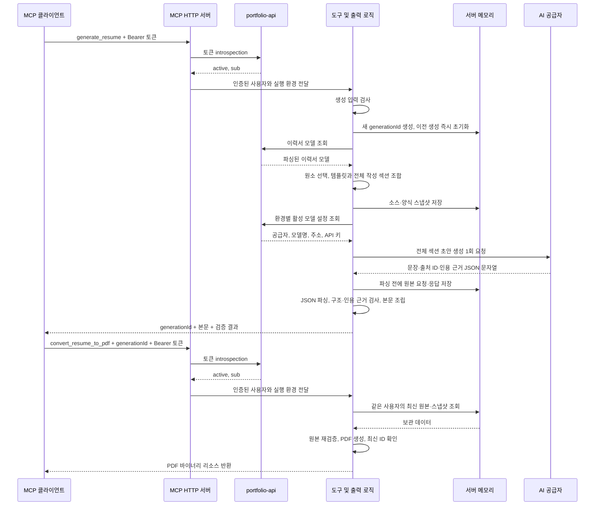

# Portfolio MCP

이력서 원문을 선택·조합하고 AI로 초안을 작성한 뒤 PDF로 변환하는 MCP 서버입니다. AI 모델 설정을 관리하는 React 관리자 화면을 같은 서버에서 제공합니다.

이 문서는 현재 브랜치의 구현 구조를 설명합니다. 운영 반영 여부는 배포 상태를 별도로 확인해야 합니다.

## 프로젝트 경계

- `mcp/`는 자체 `package.json`, `pnpm-lock.yaml`, TypeScript 설정과 컨테이너 파일을 갖습니다. 포트폴리오 웹앱의 `src/`를 가져오지 않습니다.
- `portfolio-api`는 OAuth 인증·토큰 수명주기, 이력서 원문 조회·파싱, 모델 설정·API 키 저장을 담당합니다.
- MCP는 인증 결과를 확인하고 이력서 선택·조합, 모델 호출, 내부 근거 검증과 PDF 출력을 담당합니다.
- 관리자 화면은 MCP의 관리 API를 사용하며 OAuth 토큰을 직접 다루지 않습니다.

## 디렉터리 구조

```text
mcp/
├── apps/
│   ├── console/                 운영 콘솔 (React + Vite)
│   │   └── src/
│   │       ├── pages/           login, menu, ai-models, resume-archive
│   │       └── shared/          공통 HTTP 요청, UI
│   └── backend/
│       └── src/
│           ├── interfaces/      tools, admin 소비처별 진입점
│           ├── modules/         resume, ai-models 업무 처리
│           ├── infrastructure/  ai, portfolio-api, storage, connection
│           └── bootstrap/       환경 설정, HTTP 서버, 실행 조립
├── packages/admin-contracts/    순수 메뉴·공통 계약의 공개 패키지
├── scripts/                    빌드 alias 변환·중앙 설정·Storage 점검
├── fonts/                      한글 PDF 폰트
├── docs/
├── pnpm-workspace.yaml
├── pnpm-lock.yaml
├── package.json
└── Dockerfile
```

테스트는 구현 파일 옆의 `*.test.ts` 또는 `*.test.tsx`에 둡니다. `dist/`는 서버와 관리자 화면의 빌드 산출물이며 직접 수정하지 않습니다.

## 역할별 코드 위치

### 서버와 도구

- [`apps/backend/src/bootstrap/server.ts`](apps/backend/src/bootstrap/server.ts)는 실행 설정과 외부 연결을 조립하는 진입점입니다.
- [`create-resume-mcp-server.ts`](apps/backend/src/bootstrap/create-resume-mcp-server.ts)는 HTTP 요청, Bearer 인증 확인과 서버 인스턴스의 생성 저장소를 담당합니다.
- [`handle-mcp-request.ts`](apps/backend/src/interfaces/tools/handle-mcp-request.ts)는 JSON-RPC, `tools/list`와 도구 입력 스키마를 담당합니다.
- [`resume-tools.ts`](apps/backend/src/interfaces/tools/resume/resume-tools.ts)는 도구 실행, 원문 조회·선택, 생성 ID 재실행과 PDF 변환을 연결합니다.

### 외부 연결

`connection/`은 조회 대상과 책임에 따라 나눕니다.

- `shared/`는 공통 전송 계약과 오류 타입을 소유합니다.
- `resume/`는 `repository`, `embedded`, `file` 입력을 portfolio-api에 전달하고 파싱된 이력서 모델을 받습니다. MCP가 웹앱의 XML 파서를 직접 사용하지 않습니다.
- `model/`은 모델 호출 타입, 활성 설정 조회, Chat Completions 공통 전송과 연결 테스트를 소유합니다.
- `model/providers/`는 공급자별 차이만 처리합니다. OpenAI는 Chat Completions를, Gemini는 Google의 OpenAI 호환 엔드포인트를 사용합니다. 공급자 연동 코드가 있다고 실제 모델 설정이 자동 등록·활성화되지는 않습니다.

공급자 UI의 기본 주소·모델 ID 예시·공식 목록 링크는 [`apps/console/src/settings/providers/model-providers.ts`](apps/console/src/settings/providers/model-providers.ts)의 상수로 관리합니다. 실제 모델 ID는 직접 입력합니다.

### 생성과 출력

- [`compose-resume.ts`](apps/backend/src/modules/resume/compose/compose-resume.ts)는 `elementIds`와 `sectionOrder`로 원소와 순서를 선택합니다.
- [`select-template-sections.ts`](apps/backend/src/modules/resume/compose/select-template-sections.ts)는 템플릿별 섹션 선택을 담당합니다.
- [`run-resume-harness.ts`](apps/backend/src/modules/resume/generation/run-resume-harness.ts)는 전체 선택 섹션을 한 번의 생성 요청으로 묶고 응답을 파싱·조립합니다.
- [`check-resume-draft.ts`](apps/backend/src/modules/resume/validation/check-resume-draft.ts)는 출처 ID, 누락, 충돌과 양식 항목을 검사합니다.
- [`check-resume-evidence.ts`](apps/backend/src/modules/resume/validation/check-resume-evidence.ts)는 문장에 첨부된 인용 구절이 연결된 원문에 있는지 검사합니다.
- [`resume-generation-store.ts`](apps/backend/src/modules/resume/generation/resume-generation-store.ts)는 원본 요청·응답과 소스·양식 스냅샷을 메모리에 보관합니다.
- [`create-resume-pdf.ts`](apps/backend/src/modules/resume/render/create-resume-pdf.ts)는 내부에서 조립한 본문과 검증된 출처로 PDF 바이너리를 만듭니다.

## 전체 프로세스 흐름

### 새 이력서 생성부터 PDF까지



일반적인 생성부터 PDF까지 외부 모델 호출은 총 **1회**입니다. PDF 단계에서도 인증을 위한 portfolio-api 호출은 수행하지만, 원문·활성 모델 설정을 다시 조회하거나 모델을 호출하지 않습니다. 인증이나 생성이 실패하면 해당 단계에서 오류를 반환하고 후속 단계를 진행하지 않습니다.

### 원본 재실행과 메모리 수명

`generate_resume`에 `generationId`만 전달하면 보관된 원본으로 파싱·내부 검증·본문 조립을 다시 실행합니다. `convert_resume_to_pdf`에도 같은 ID만 전달합니다. 두 경로 모두 모델을 다시 호출하지 않습니다.

1. 메모리는 인증 결과의 `sub`와 서버 실행 환경을 기준으로 분리하며, 각 범위의 최신 생성 한 건만 보관합니다.
2. 새 생성 요청이 접수되면 비동기 원문 조회와 모델 호출 전에 이전 원본·스냅샷·ID를 초기화합니다. 새 요청이 실패해도 이전 결과를 복구하지 않습니다.
3. 원본 응답은 파싱 전에 저장하므로 파싱·검증·PDF 변환 실패 후에도 재실행할 수 있습니다. 같은 원본에 같은 오류가 있으면 재실행에서도 오류를 반환하며 자동으로 새 초안을 만들지 않습니다.
4. 늦게 완료된 이전 모델 응답이나 PDF 작업은 최신 결과를 덮어쓰거나 이전 결과를 성공 응답으로 반환하지 못합니다.
5. 프로세스 종료·배포·Cloud Run 인스턴스 교체 시 메모리는 사라집니다. 인스턴스 간 공유와 시간 기반 만료, 디스크·DB 저장은 없습니다.

원본은 모델이 반환한 이력서 JSON 문자열이며 공급자 HTTP 응답 전체가 아닙니다. 저장소에는 작성 요청의 `persona`, `prompt`, `responseFormat`도 보관하지만 API 키와 인증 토큰은 넣지 않습니다. 클라이언트가 수정한 `generatedResume`, 본문이나 `selection`을 PDF 입력으로 받지 않습니다.

대표 오류는 원본 수신 전의 `GENERATION_NOT_READY`, 다른 사용자·환경·이전 ID 또는 없는 결과의 `GENERATION_NOT_FOUND`, 요청자·환경 식별이 없는 실행의 `GENERATION_CONTEXT_REQUIRED`입니다. 원본이 없다고 모델을 자동 재호출하지 않습니다.

### 검증 범위와 호출 횟수의 예외

검증 결과의 `validationMode`는 `source_evidence`입니다. 출처 연결과 원문 인용 일치를 확인하며, 별도 AI 의미 검증은 수행하지 않습니다. 인용이 일치한다고 생성 문장 전체의 의미가 증명되는 것은 아닙니다.

- `claims`를 직접 제출하는 생성 경로는 인용 근거를 내부 검사하며 모델 호출은 **0회**입니다.
- 관리자 연결 테스트는 일반 응답과 구조화 응답을 확인하므로 최대 **2회** 호출합니다. 일반 호출이 실패하면 두 번째 호출은 수행하지 않습니다. 이력서 생성의 1회 호출 계약과 별도입니다.

### 관리자 모델 설정 흐름

1. 사용자가 `/admin/ai-models`에서 로그인을 시작하면 MCP의 `auth/admin-oauth.ts`가 portfolio-api OAuth 흐름을 연결합니다.
2. 인증 후 서버가 세션 쿠키를 관리하고, React 화면은 `/admin/ai-models/api/*`를 호출합니다.
3. `auth/admin-routes.ts`가 세션·같은 출처·메서드를 확인하고 `auth/admin-api.ts`를 통해 portfolio-api의 설정 API로 전달합니다.
4. 모델 설정과 키는 portfolio-api가 저장합니다. 설정 등록·수정과 활성화는 구분되며, 새 이력서 생성은 실행 환경의 활성 설정을 조회합니다.
5. 연결 테스트는 선택한 설정의 ID와 환경을 확인한 뒤 해당 공급자를 호출합니다. 다른 설정으로 대체하거나 자동 활성화하지 않습니다.

## 실행과 검증

저장소 루트 기준으로 실행합니다. 환경 준비와 인증·배포 설정은 아래 상세 문서를 참고합니다.

MCP 정적 검사는 `pnpm --dir mcp lint`로 Oxlint를 실행합니다. 오류는 실패로 처리하고 경고는 허용합니다. `pnpm --dir mcp lint:verify`는 콘솔 React 규칙을 포함한 fixture 12개와 종료 코드 정책을 확인합니다. 두 명령은 CI와 Compose 검증에 포함합니다. 비교 측정은 `pnpm --dir mcp lint:evaluate`로 실행하며 [MCP 평가 결과와 검사 범위](docs/oxlint-evaluation.md)를 참고합니다. 웹 ESLint는 별도로 유지합니다.

```sh
# MCP 전용 의존성 설치
pnpm --dir mcp install --frozen-lockfile

# 서버 타입 검사, alias 변환, 관리자 화면 빌드
pnpm --dir mcp build

# 백엔드·공통 계약·구조 Jest + 콘솔 Vitest
pnpm --dir mcp test

# 개별 실행
pnpm --dir mcp test:backend
pnpm --dir mcp test:console

# CI 실행
pnpm --dir mcp test:ci

# 준비된 .env를 읽어 MCP 서버 실행
pnpm --dir mcp start
```

서버 빌드는 `@mcp/*` import를 Node에서 실행 가능한 상대경로로 변환합니다. 서버 진입 산출물은 `apps/backend/dist/bootstrap/server.js`이고, 관리자 화면 산출물은 `apps/console/dist/`입니다.

## 상세 문서

- [환경 설정과 생성 원본 재실행](docs/environment.md)
- [OAuth 게이트웨이·클라이언트 연결·배포](docs/oauth-gateway.md)
- [이력서 PDF 항목 매핑](docs/jobkorea-resume-pdf-map.md)
- [에이전트 작업 지침](AGENTS.md)

## Workspace 구조

- `apps/console`은 운영 콘솔이며 페이지는 `src/pages`, 공통 UI와 HTTP 요청은 `src/shared`에 둡니다.
- `apps/backend`는 MCP 도구와 관리자 API를 제공하는 모듈형 모놀리스입니다. `interfaces`는 소비처별 진입점, `modules`는 업무 처리, `infrastructure`는 외부 연결, `bootstrap`은 실행 조립을 소유합니다.
- `packages/admin-contracts`는 콘솔과 백엔드가 공유하는 메뉴의 단일 소유자입니다. 두 앱은 `workspace:*` 의존성과 공개 패키지 이름으로 연결합니다.
- MCP 루트에서 `pnpm install --frozen-lockfile`, `pnpm build`, `pnpm type-check`, `pnpm test`를 실행합니다. 공통 계약을 먼저 빌드하므로 개별 앱 개발 전에 `pnpm --filter @portfolio-mcp/admin-contracts build`를 실행합니다.
- 배포 단위는 하나이며 Docker가 세 패키지를 빌드하고 백엔드가 콘솔 정적 파일을 서빙합니다. 기존 OAuth 경로와 도구·Storage 계약을 유지합니다.

`pnpm check:build`는 실제 빌드 산출물로 로컬 HTTP 테스트 서버를 잠시 실행해 기본 콘솔·에셋 경로, MCP 도구 등록, 한글 PDF 생성을 검증합니다. 외부 API나 모델을 호출하지 않습니다.

파일·폴더와 코드 식별자는 [MCP 명명 규칙](docs/naming-conventions.md)을 따릅니다.

### 테스트 실행기 독립성

`mcp/`는 Jest·SWC·테스트 타입과 콘솔 Vitest를 자체 manifest·lockfile에서 관리합니다. 상위 웹 앱의 Next.js·Jest setup·경로 별칭을 가져오지 않습니다. `pnpm test:ci`는 백엔드 커버리지를 MCP 루트 `coverage/`에 기록하며 CI는 웹 앱 커버리지와 함께 업로드합니다. `mcp/`만 분리한 디렉터리에서도 `pnpm install --frozen-lockfile`, `pnpm build`, `pnpm test`, `pnpm type-check`, `pnpm check:build`를 실행할 수 있습니다. 콘솔이 공통 계약의 빌드 결과를 사용하므로 전체 테스트 전에 `pnpm build`를 실행합니다.

상위 저장소의 GitHub Actions 파일 검사는 그 파일을 소유하는 `tests/infrastructure/deploy.workflow.test.ts`에 둡니다. MCP 테스트는 자신의 Dockerfile·시작 스크립트·코드·패키지만 검사하며 부모 저장소 파일을 읽지 않습니다.

로컬 컨테이너 실행과 검증은 [Compose 가이드](docs/local-compose.md)의 `pnpm local:up`, `pnpm local:down`, `pnpm verify:container`를 사용합니다. 서버 설정은 portfolio-config development로 고정합니다.

로컬·운영 이미지는 빌드 시 최신 정식 portfolio-config CLI를 조회합니다. 운영 `Deploy MCP`의 수동 실행으로 코드 변경 없이 최신 CLI를 재배포할 수 있으며, 실행 중인 이미지의 CLI는 자동으로 바뀌지 않습니다.
